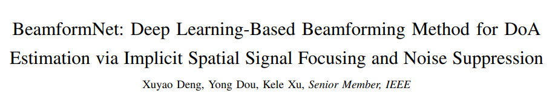
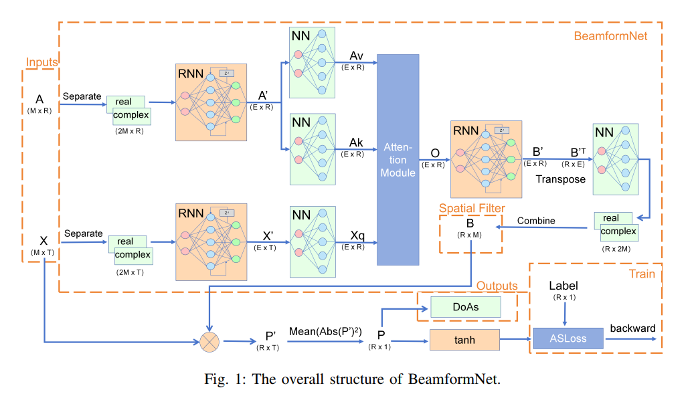
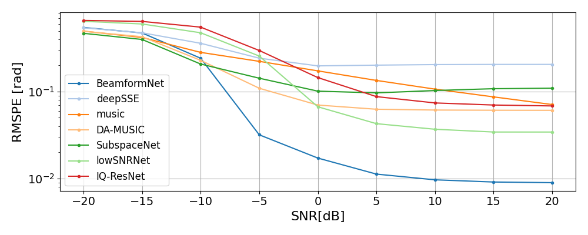
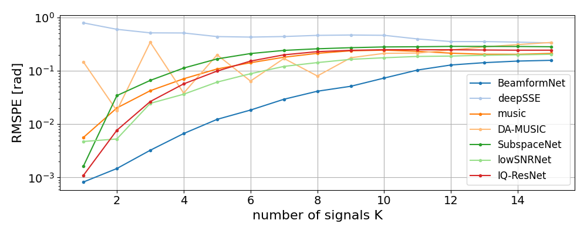
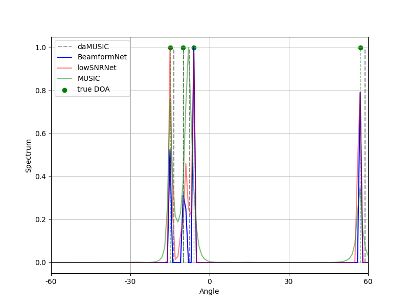
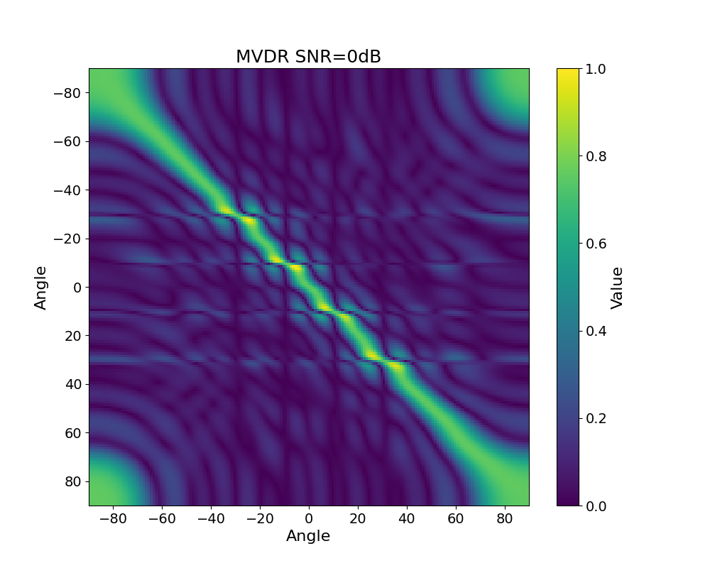
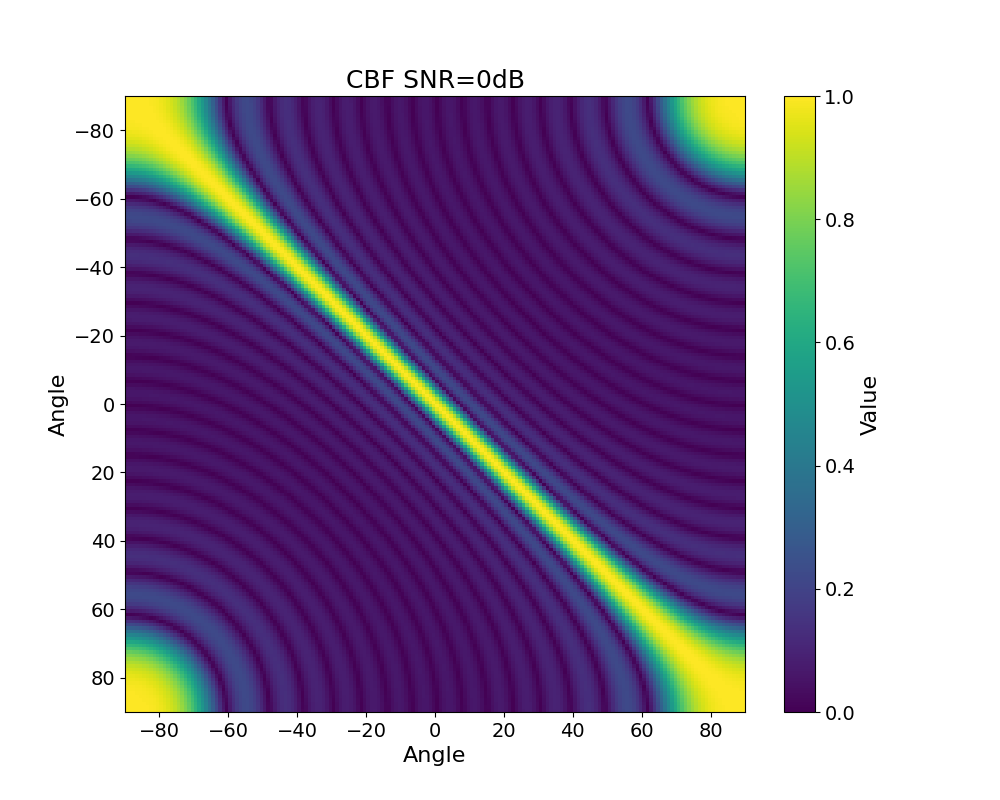
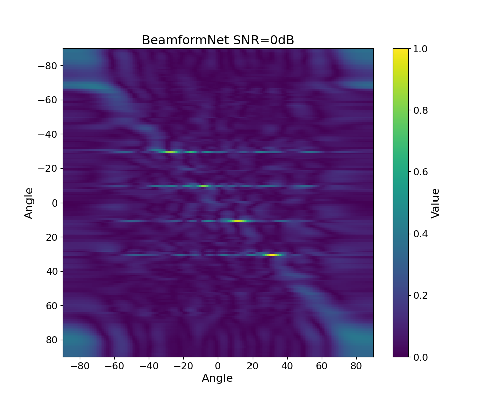

# [National University of Defense Technology's latest research] BeamformNet: Deep Learning-Based Beamforming Method for Implicit Spatial Signal Focusing and Noise Reduction [with Python code attached]

As a foundational task in array signal processing, direction of arrival (DoA) estimation has permeated multiple critical fields such as acoustic source localization, radar detection, and wireless communication—its core goal is to precisely infer the angular information of the signal source by receiving signals through sensor arrays. However, traditional methods often fall into the dilemma of "idealistic but harsh reality" in real-world scenarios. A new framework that integrates the principles of traditional beamforming with the advantages of deep learning is providing a fresh approach to solving this problem.
Traditional DoA estimation's "weak points": performance degradation in complex scenarios
Traditional DoA estimation relies on model-driven beamforming methods, such as conventional beamforming (CBF), minimum variance uncorrelated linear estimate (MVUE), and MUSIC algorithm. These methods are based on explicit signal model assumptions and can operate stably under ideal conditions (uncorrelated sources, sufficient number of shots, perfect array calibration). However, once they encounter the "complex working conditions" of real-world scenarios, they tend to experience a cliff-like decline in performance:
✧
Coherent source interference: when multiple signal sources have correlation due to multipath propagation, traditional methods fail due to the rank deficiency of the signal covariance matrix;
✧
Less shot data: scenarios involving instantaneous signals or moving sources are difficult to obtain sufficient signal snapshots, leading to a significant reduction in filter estimation accuracy;
✧
Non-ideal environment: sensor position errors, mutual coupling effects, strong background noise, etc., can destroy the ideal assumptions of the signal model, resulting in significant deviations in the positioning results.
The rise of deep learning brings hope for solving these problems—the data-driven nature allows models to adapt to non-ideal conditions. However, the "black box" nature and limited interpretability make many engineering scenarios reluctant to accept it. Finding a balance between "principle interpretability" and "robustness to complex scenarios" has become a key breakthrough in the field of DoA estimation.
II. Core Innovation: The new framework for deep learning, which closely approaches the "optimal spatial filter" in core ideas, deeply integrates the "interpretability" of traditional beamforming with the "strong fitting capability" of deep learning. It essentially aims to approximate an "optimal spatial filter" through neural networks, achieving dual objectives of signal focusing and noise suppression. This approach not only preserves the principle logic but also breaks through the constraints of model assumptions.
1. Optimal Spatial Filter: The "ideal target" for DoA estimation is essentially constructing a spatial filter B, which filters the received signal X to obtain the spatial energy spectrum P, and then determines the DoA by spectral peak detection. The framework defines an "optimal spatial filter B*", which must meet two core conditions:
✧
Signal focusing: B*×A×S = S (A is the array manifold matrix containing all possible steering vectors for all possible directions; S is the signal source matrix) - allowing the filter to retain only the target signal, filtering out irrelevant interference;
✧
Noise suppression: B*×N = 0 (N is the noise matrix) - completely cancelling the background noise effect.
Theoretically, under the assumptions of sparse signal model (where the signal source is sparsely distributed in space, most directions have no signal), and "K < M" where K is the number of signal sources and M is the number of sensors, this optimal filter must exist: The degree of freedom of the filter is determined by the number of sensors M, while the constraints from signals and noise are K and 1 respectively, leaving enough degrees of freedom to satisfy both conditions.
Traditional methods attempt to solve B through analytical formulas, but are limited by model assumptions and difficult to adapt to complex scenarios; the core of the new framework lies in using deep learning to "learn" this optimal filter B*, balancing interpretability and robustness.
2. How does the neural network "learn" the optimal filter? Based on the universal approximation theorem (neural networks can approximate any mapping with arbitrary precision under mild conditions), the framework designs targeted network architectures to achieve precise mapping from "input signal + spatial information" to "optimal filter":
(1) Input and feature extraction: The input to the model includes two core information elements: the array manifold matrix A (representing spatial information) and the received signal matrix X (representing time-series information). Since the phase of complex signals is crucial for direction of arrival (DoA) estimation, the model first separates A and X into their real and imaginary parts, then inputs them into a bidirectional RNN to extract contextual features in both spatial and temporal domains; simultaneously, by employing dimension expansion (virtual elements), the model enhances its feature representation capability, laying the foundation for subsequent filtering.
(2) Attention fusion: Focus on the spatial regions with signals. In traditional beamforming, it requires integrating spatial steering vectors and received signal information. This framework introduces an attention module to achieve adaptive focusing: using the received signal features as "queries" and the spatial steering vector features as "keys" and "values", the model assigns weights to different directions based on similarity computation, allowing the model to automatically focus on the "spatial grid with signals," avoiding interference from irrelevant areas, and enhancing the precision of the filters.
(3) Filter generation and spatial spectrum calculation: After feature fusion, the network generates the final spatial filter B (combining the real and imaginary parts into a complex matrix) through RNN and linear layers. Applying B to the received signal X yields a preliminary spatial spectrum P', and then, through "modulus square + time-dimension average," obtains the final spatial energy spectrum P—the peak of the spectrum corresponds to the estimated DoA.
3. Loss function design: Solving the "spectral peak cannot be backpropagated" issue. Traditional methods use spectral peak search to estimate DoA, but this "search process" cannot be directly used for neural network backpropagation training. The solution proposed by this framework is highly ingenious:
✧  
Probabilistic transformation: Use the tanh activation function to map the energy values of the spatial spectrum P ([0, +∞)) to the [0,1] interval, converting it into "probability distribution of presence of signals at certain orientations";
✧
Multi-label classification modeling: Transforming DoA estimation into a multi-label classification problem of "which spatial grids contain signals". By leveraging the sparsity of signals in space (most grids are devoid of signals), employing an asymmetric loss (ASL) to address the imbalance between positive and negative samples, the model focuses more on the few grids that contain signals, thereby enhancing positioning accuracy.
III. Why can it break through complex scenarios? The core advantages brought by the principle are reflected in the performance improvement of this framework, which stems from the dual effects of "optimal filter approximation" and "deep learning adaptive", specifically manifested as:
✧  
Coherent source adaptation: No need for additional decoupling processing. The filters learned by the neural network can automatically separate coherent signals, solving the core pain points of traditional methods.
✧  
Robustness of Fast Snapshots: RNN can extract temporal domain features from limited snapshots, and its performance rapidly surpasses traditional methods as the number of snapshots increases.
✧  
Wide SNR Compatibility: Signal focusing capability is outstanding under medium to high SNR, with the highest positioning accuracy; under low SNR, the noise suppression mechanism can significantly improve signal quality (in experiments, the SNR was boosted from -15dB to 13.3dB).
✧  
Robust array expansion: as the number of sensors increases, the growth in model parameters is gradual and significantly lower than traditional data-driven methods, making it suitable for large-scale array deployment.
✧  
Real-world application: In a real speech data set containing multipath propagation, broadband signals, and complex environmental noise, the principle still maintains optimal positioning accuracy, demonstrating its engineering practicality.
IV. Future Directions: Breakthrough in Extreme Scenarios The framework has been validated in both simulated data and real scenarios, but there is still room for further optimization: For extreme conditions such as "Single Fast Snapshot" (only one signal snapshot) and "Extremely Low SNR" (below -20dB), it is necessary to strengthen the feature extraction and noise suppression modules in the time domain. At the same time, reducing the model complexity to adapt to edge devices (such as small microphone arrays) will become the focus of subsequent research.
Conclusion: This "principle-driven + data empowerment" approach provides a novel paradigm for DoA estimation—rather than treating deep learning as a "black box replacement," it anchors on the core principles of traditional beamforming. It uses neural networks to address the pain point of "difficult to analytically solve optimal filters." This design that balances interpretability and robustness not only breaks through the bottleneck in complex scenarios but also provides a reference for more array signal processing tasks, promoting the broader application of related technologies in real-world scenarios.

## Images

<!-- PAYMENT_BLOCK -->

## Get this dataset

- Payment link (Stripe): [Buy now](https://buy.stripe.com/3cs8yP7sY87d0vu9AB)
- Payment QR code: 

<!-- /PAYMENT_BLOCK -->
